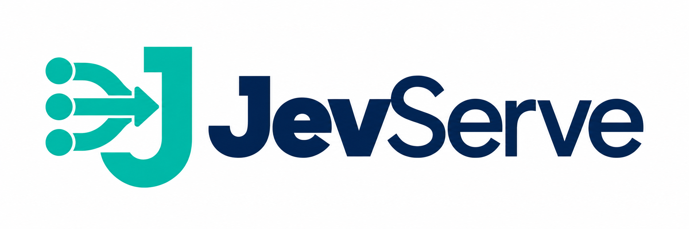

<p align="center">
  
</p>

<p align="center"><strong>文本进来，决策出来。</strong></p>
<p align="center">在自己的 GPU 上运行决策模型，通过一个 HTTP API 调用。</p>
<p align="center"><a href="README.md">English</a> · <a href="#快速开始">快速开始</a> · <a href="docs/quickstart.md">部署指南</a> · <a href="compat/README.md">API 兼容范围</a></p>

JevServe 将开源 Jev 类决策模型封装成 HTTP 服务。发送文本和问题，获得带概率的类型化答案。你可以用它分派客服工单、识别紧急消息，或按规则给内容评等级。

| 想做什么 | 问题类型 | 返回什么 |
|---|---|---|
| 选择处理工单的团队 | **Choice** | 一个标签，以及各候选项的概率 |
| 判断消息是否紧急 | **Noul** | 0–1 之间的概率 |
| 按低、中、高评定优先级 | **Score** | 等级期望值，以及各等级的概率 |

底层使用 **vLLM**，提供 Python 客户端、有界请求队列、取消、健康检查和离线模式。目前支持 **[Open-Jev-2B](https://huggingface.co/ZefanCai/Open-Jev-2B)**。

> **开发预览版。** 真实 GPU 推理已跑通，与作者实现的数值一致性尚未认证。依赖模型结果之前，请阅读[当前状态与限制](#当前状态与限制)。

## 快速开始

需要 **Linux x86_64、NVIDIA GPU、Docker 和 NVIDIA Container Toolkit**。宿主机不需要安装 Python 或 CUDA Toolkit。已测试的主机使用 RTX A6000，详见[运行要求](docs/quickstart.md#requirements)。

下载本仓库源码后，在仓库目录执行：

```bash
./scripts/quickstart.sh --build
```

脚本会构建开发镜像，在 `127.0.0.1:8000` 启动服务，等待模型就绪，然后执行包含三种问题类型的真实请求。成功后服务继续运行。首次启动下载固定版本的模型，后续复用 `jevserve-cache` 卷。

**Docker Hub 发布正在准备中。** 在实测镜像发布之前，上述命令使用本地构建；目前不提供未经发布验证的拉取地址。

### 发起一个决策请求

```bash
curl -fsS http://127.0.0.1:8000/v1/decisions \
  -H 'Content-Type: application/json' \
  -d '{
    "state": "I was charged twice and want a refund.",
    "questions": {
      "team": {
        "type": "choice",
        "instructions": "Which team should handle this?",
        "criteria": {
          "billing": "Payments and refunds",
          "technical": "Software and setup"
        }
      }
    }
  }'
```

从 `answers.team.choice` 读取选中的团队，从 `answers.team.probabilities` 读取候选分布。响应同时提供模型 revision 与执行配置标识。[三种问题类型的完整示例](examples/decision.json)。

### 使用 Docker Compose

```bash
docker compose up --build -d
docker compose exec jevserve jevserve check --wait-seconds 1800
```

Quick Start 和 Compose 二选一使用端口 8000。[自定义端口、GPU、鉴权、离线启动与清理 →](docs/quickstart.md)

## 在 Python 中使用

原生客户端接受与 HTTP API 相同的请求字典：

```python
from jevserve.client import Client

with Client("http://127.0.0.1:8000") as client:
    result = client.decide({
        "state": "Production is down for all users.",
        "questions": {
            "urgent": {
                "type": "noul",
                "instructions": "Does this need an urgent response?",
            }
        },
    })
    print(result.answers["urgent"].noul)
```

在 Python 3.12 虚拟环境中，从本仓库运行 `pip install .` 安装客户端。客户端不安装 GPU 依赖，也不自动重试。`/v1/systemone` 支持经过测试的 `typesafe-sdk==0.7.4` 文本问题子集，详见[兼容范围](compat/README.md)。

## 当前状态与限制

- **模型：** Open-Jev-2B；仅文本，一个容器对应一个模型和一个 GPU。
- **数值：** 最新 pooling 对照中，38/113 条超过预先固定的概率容差，未观察到标签翻转。概率不等于经过校准的正确率。[验证报告](docs/development/STATUS.md)。
- **输入：** 最多 16 个问题；Choice 最多 255 个候选项；Score 为 2–10 个文本等级。另有 token 和计算量上限，不静默截断、改变精度、切换模型或重试。
- **发布：** 当前是开发预览版，尚非通过 alpha 认证的版本或生产版。[容器与发布进度](docs/development/STATUS.md)。

## 文档与贡献

[部署指南](docs/quickstart.md) · [开发环境](docs/development/IMPLEMENTATION.md) · [架构](docs/plans/JevServe-design.md) · [模型详情](docs/models.md) · [贡献指南](CONTRIBUTING.md)

```bash
uv sync --locked
uv run pytest -q
uv run ruff check .
uv run mypy
```

CPU 测试无需 GPU 或模型下载。欢迎提交问题和改进；报告问题时请附上运行版本和最小复现示例。

## 许可证

Apache-2.0。上游代码与模型的许可证见 [NOTICE](NOTICE) 和[模型详情](docs/models.md)。

JevServe 独立于 TypeSafe AI 与 JevServe-Bench，不包含 TypeSafe 官方 Jev 权重。
